# Jobinfo India database architecture

## Scope and current implementation

PostgreSQL is the system of record. The API accesses it through the shared Prisma package at `packages/database`; web clients call the versioned Express API and never connect to PostgreSQL directly. IDs currently use Prisma `cuid()` values. Converting existing production identifiers to UUIDs would be a breaking migration, so new identifiers should follow the current format unless a separately planned migration establishes a UUID boundary.

The schema is a production-oriented MVP, not yet the full normalized target from the backend master prompt. The diagram below describes models that exist today. It deliberately does not depict proposed tables as if they were already deployed.

## ER diagram (implemented schema)

```mermaid
erDiagram
  USER ||--o| CANDIDATE : owns
  USER ||--o| EMPLOYER : owns
  USER ||--o| INSTITUTION : administers
  USER ||--o| BILLING_PROFILE : has
  USER ||--o{ OTP_CODE : verifies
  USER ||--o{ NOTIFICATION : receives
  USER ||--o{ SUBSCRIPTION : purchases
  USER ||--o{ PAYMENT_TRANSACTION : pays
  USER ||--o{ TAX_INVOICE : billed
  USER ||--o{ RECRUITER_JOB_DRAFT : authors
  USER ||--o{ JOB_TEAM_MEMBER : joins
  USER ||--o{ JOB_POSTING_TRANSACTION : pays

  CANDIDATE ||--o{ CANDIDATE_SKILL : lists
  CANDIDATE ||--o{ EDUCATION : studied
  CANDIDATE ||--o{ WORK_EXPERIENCE : worked
  CANDIDATE ||--o{ CERTIFICATION : earned
  CANDIDATE ||--o{ APPLICATION : submits
  CANDIDATE ||--o{ SAVED_JOB : saves

  EMPLOYER ||--o{ JOB : posts
  JOB ||--o| RECRUITER_JOB_DRAFT : draft
  JOB ||--o{ JOB_SKILL : requires
  JOB ||--o{ JOB_REQUIREMENT : specifies
  JOB ||--o{ JOB_BENEFIT : offers
  JOB ||--o| JOB_APPLICATION_SETTING : configures
  JOB ||--o{ JOB_SCREENING_QUESTION : asks
  JOB_SCREENING_QUESTION ||--o{ JOB_SCREENING_OPTION : offers
  JOB ||--o{ JOB_TEAM_MEMBER : assigns
  JOB ||--o{ JOB_VIEW : records
  JOB ||--o{ JOB_STATUS_HISTORY : tracks
  JOB ||--o{ JOB_POSTING_TRANSACTION : charges
  JOB ||--o{ APPLICATION : receives
  JOB ||--o{ SAVED_JOB : saved
  APPLICATION ||--o{ JOB_SCREENING_ANSWER : answers

  INSTITUTION ||--o{ DEPARTMENT : has
  INSTITUTION ||--o{ INSTITUTION_STUDENT : manages
  INSTITUTION_STUDENT ||--o{ INSTITUTION_PLACEMENT : tracks

  SUBSCRIPTION ||--o{ PAYMENT_TRANSACTION : paid_by
  PAYMENT_TRANSACTION ||--o| TAX_INVOICE : invoiced
  JOB_POSTING_TRANSACTION ||--o| TAX_INVOICE : invoiced
```

`AuditLog.actorId`, `RolePermission.updatedById` and `CustomAiIntegration.updatedById` are actor identifiers without enforced User foreign keys. `Subscription.planCode` is a code snapshot and is not currently a foreign key to `SubscriptionPlan`.

## Relationship and deletion policy

- User-owned profile records (candidate, employer, institution) are one-to-one where the role applies. Institution `userId` is optional for imported/unclaimed institutions.
- Candidate/job application uniqueness is enforced by `@@unique([candidateId, jobId])` to prevent duplicate applications.
- Candidate skills and job skills are currently child rows with unique names per parent, rather than a shared canonical `Skill` dictionary.
- Institution students are scoped to an institution and have unique email within that institution. Recruiter visibility is opt-in (`recruiterVisible=false`). The current table does not yet capture a versioned consent record.
- Profile data cascades with its owner where removal is appropriate. Payment, subscription, invoice and posting-payment records use restrictive owner references so account deletion cannot silently erase financial history. Optional payment-to-subscription/invoice references use `SET NULL` where historical documents should survive.
- Audit logs intentionally have no cascading actor relation; records can remain after account anonymization.
- Existing text status/type columns remain strings where the UI/business process is still evolving. A future enum migration must validate and map existing values before making them strict.

## Index and integrity strategy

- Unique constraints: normalized login email, optional unique phone, candidate per user, employer per user, institution per user, candidate/job application pair, institution-scoped student email, unique public job slug/reference, provider payment reference, invoice number, subscription plan code, and one custom AI integration row.
- Workload indexes cover published/status job listings, candidate searchability and update recency, application lists by candidate/job and application time, institution student visibility/passing year/department, notifications, billing history, and audit lookup.
- Prisma migrations are additive after `20261111_000000_baseline`. Existing deployments must be backed up and schema-diffed before marking the baseline applied; never use `db push` against production.
- The integrity migration adds billing foreign keys. It will correctly fail if existing records contain orphaned billing references; operators must reconcile those rows before applying it.

## Current gaps against the requested target

These are not implemented as separate normalized tables yet:

1. Authentication: refresh-token/session records, password-reset records, login history and account-verification records. Current access tokens use a database-backed `sessionVersion` revocation mechanism; this is not refresh-token rotation.
2. RBAC: users have one `UserRole`; `RolePermission` gates admin capabilities. There is no multi-role `UserRole` join, role catalog, or general `RolePermission` relation. Team permissions are stored per job membership.
3. Candidate data: address, language, project, resume-version, preference, social-profile, profile-view and normalized shared skill tables. Resume key/URL currently lives on Candidate, and candidate skills are strings.
4. Organization structure: company branches/departments, recruiter-company memberships and invitations. Current Employer is one recruiter-owned company profile.
5. Job catalog/engagement: category/function/type catalogs, normalized locations, saved searches, reports, and explicit application-status history. Job status history exists; application status currently lives on Application.
6. Institution operations: institution profiles, admin/placement-officer roles, courses, batches, student education, versioned consent, verification documents and recruiter-access grants. Current student consent is represented by the visibility flag.
7. ATS: AI integration configuration and recruiter-facing scoring workflows exist, but durable parse/analysis/match/score/interview/pipeline records are not yet modeled as first-class tables.
8. Monetization: plan, subscription, payment, posting transaction, invoice and billing-case records exist. Dedicated webhook-event idempotency ledger, invoice items, coupons, tax configuration and refund records are not yet separate models.
9. Communication/compliance: in-app notifications, templates, privacy workflows and audit records exist; delivery logs/preferences, support tickets, detailed file access, retention policies, security events, API keys and webhook delivery records are missing.

## Safe implementation sequence

1. Preserve existing working endpoints and schema. Validate migration chain on a disposable PostgreSQL instance and snapshot the current deployment before structural migrations.
2. Add the authentication/RBAC join tables and backfill the current `User.role` into an explicit grant before allowing multiple roles. Keep the legacy field until all API guards and clients read grants.
3. Add normalized candidate resume, preference, consent and recruiter-company membership tables. Backfill from current Candidate/Employer/InstitutionStudent fields and dual-read during transition.
4. Add job taxonomy and application status history; write status transitions transactionally and backfill current statuses.
5. Add institution access/consent and ATS processing records, then billing webhook idempotency and notification delivery records.
6. Remove denormalized legacy columns only in a separately reviewed cleanup migration after code and data audits.

## Database runtime checks

- `npm run db:generate` generates the Prisma client.
- `npm run typecheck` and `npm run build` validate TypeScript integration across database, API and web.
- `prisma validate` checks schema structure without a database.
- `prisma migrate deploy` against disposable PostgreSQL is required to validate the actual migration chain. This workspace currently has no configured PostgreSQL URL/server, so the chain has not been applied here.
